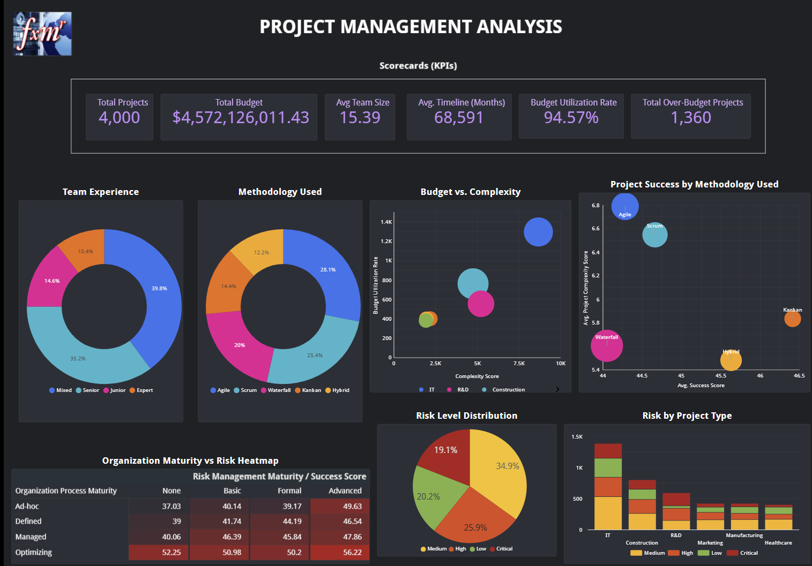
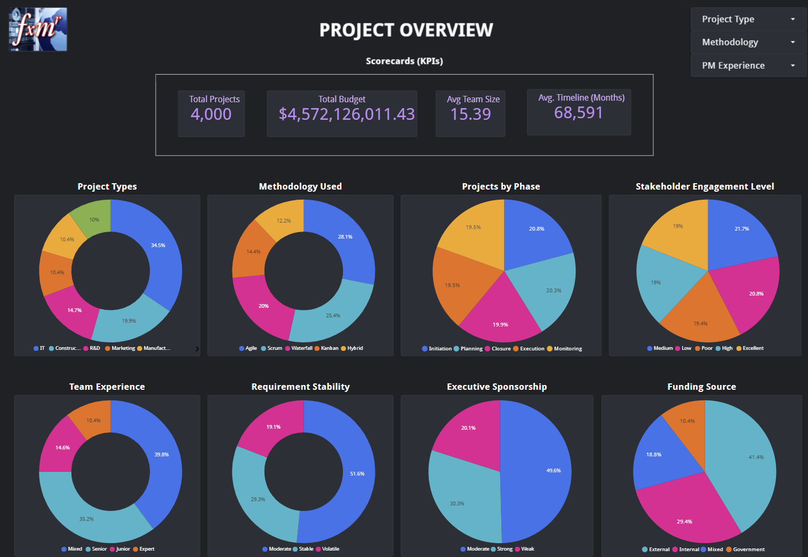
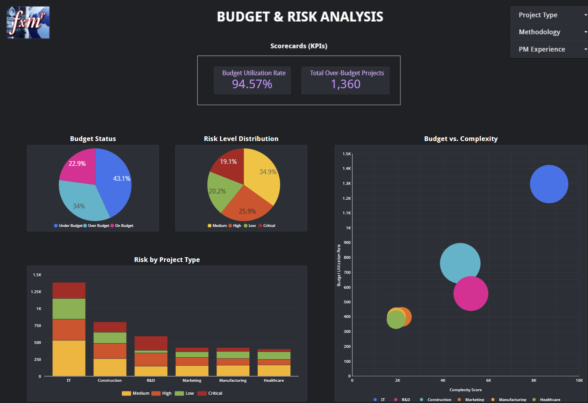
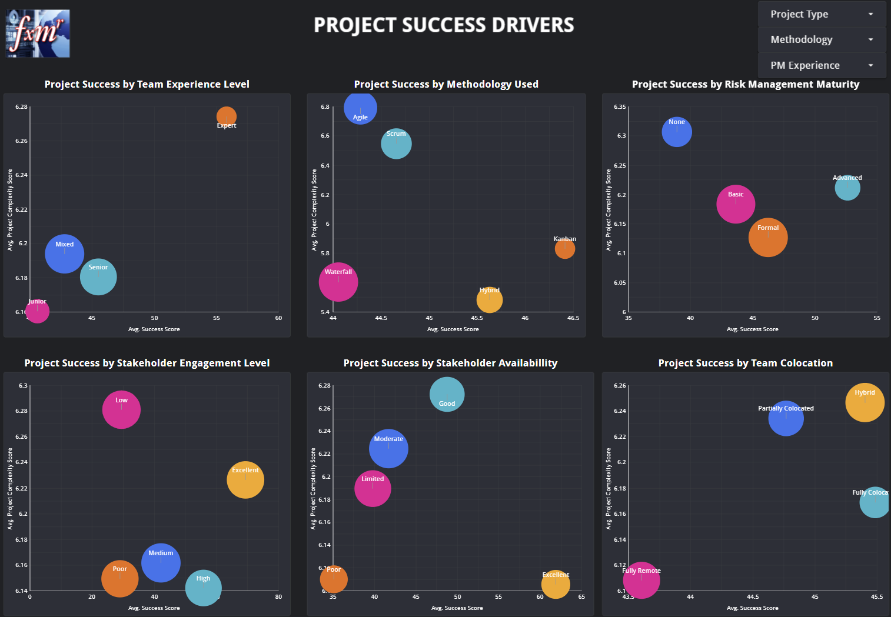
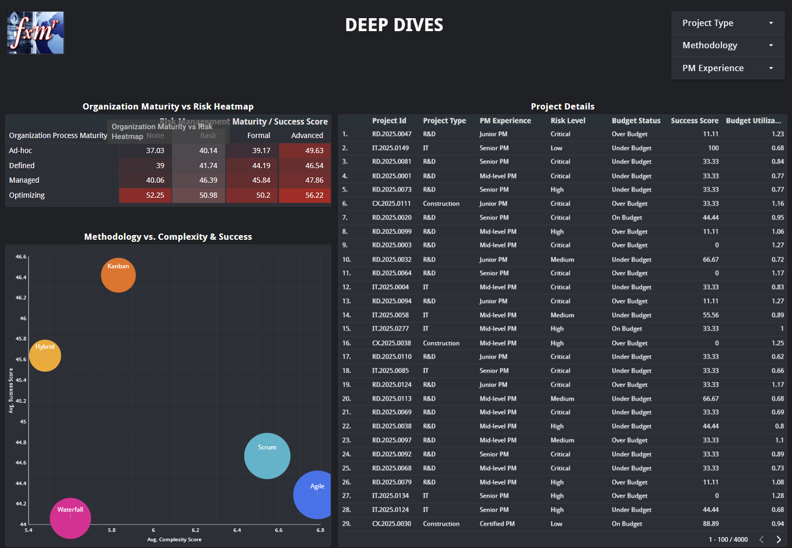

> **Portfolio Project — Skill Demonstration**
> Built on an anonymized enterprise project portfolio dataset (4,000 projects, $4.57B combined
> budget) spanning 6 industries and 5 project management methodologies. This is not derived from
> a client engagement. The analytical questions, KPI design, and success factor framework reflect
> 30+ years of direct PMO leadership experience — including management of a $73M BSS/OSS
> transformation at Amdocs and current oversight of CNT EP's $84M annual infrastructure program.

# 📋 Project Management Analysis System

[](https://powerbi.microsoft.com/)
[]()
[]()

> **Transforming a portfolio of 4,000 enterprise projects into actionable PMO intelligence — budget performance, risk concentration, success factor analysis, and organizational maturity benchmarking.**



---

## 📋 Table of Contents

- [Project Overview](#-project-overview)
- [Key Features](#-key-features)
- [Dashboard Pages](#-dashboard-pages)
- [Dashboard Construction Process](#-dashboard-construction-process)
- [The Analytical Questions](#-the-analytical-questions)
- [Development Process](#-development-process)
- [Technical Outcomes](#-technical-outcomes)
- [Lessons Learned](#-lessons-learned)

---

## 🎯 Project Overview

A **four-page Power BI analytics platform** designed to answer the questions a PMO Director and C-suite stakeholders face when managing a large, multi-industry project portfolio:

- 📊 **Portfolio Composition** — Distribution across 6 industries, 5 methodologies, and 4 experience levels
- ⚠️ **Budget & Risk Intelligence** — Where are overruns concentrated, and how does risk map to industry type?
- 🏆 **Success Factor Analysis** — Which of six critical factors most strongly predicts project success?
- 🔬 **Organizational Maturity Deep Dive** — How do process maturity and risk maturity interact to drive outcomes?

The analytical framework draws directly on 20+ years of portfolio leadership, including PMO management for a 230-person global team at Amdocs and current oversight of CNT EP's $84M annual infrastructure portfolio.

### Quick Stats

| Metric | Value |
|--------|-------|
| **Total Projects** | 4,000 |
| **Total Portfolio Budget** | $4,572,126,011.43 |
| **Average Team Size** | 15.39 members |
| **Budget Utilization Rate** | 94.57% |
| **Over-Budget Projects** | 1,360 (34%) |
| **Dashboard Pages** | 4 |

---

## ⚡ Key Features

- ✅ **Portfolio Distribution Analysis** — Industry, methodology, experience, and lifecycle breakdowns
- ⚠️ **Budget & Risk Heat Mapping** — Identifies risk concentrations across a $4.57B portfolio
- 🏆 **Six-Factor Success Analysis** — Scatter plot correlations: success score vs complexity across each critical PMO driver
- 🔬 **Organizational Maturity Heatmap** — 4×4 matrix of success scores across process and risk maturity levels
- 🔍 **Interactive Cross-Filtering** — Slice by project type, methodology, and PM experience level simultaneously
- 📊 **Drill-Down Data Table** — Row-level project data accessible from any dashboard view
- 🧩 **Multi-Methodology Benchmarking** — Direct performance comparison: Agile, Scrum, Waterfall, Kanban, Hybrid

---

## 📊 Dashboard Pages

### 1️⃣ Project Overview

**Purpose**: Establish the portfolio baseline — how are 4,000 projects distributed across every key dimension?



**Portfolio Distribution**:

| Dimension | Breakdown |
|---|---|
| **Industry** | IT 34.5% · Construction 19.9% · R&D 14.7% · Marketing 10.4% · Manufacturing 10.4% · Healthcare 10% |
| **Methodology** | Agile 28.1% · Scrum 25.4% · Waterfall 20% · Kanban 14.4% · Hybrid 12.2% |
| **Team Experience** | Mixed 39.8% · Senior 35.2% · Junior 14.6% · Expert 10.4% |
| **Lifecycle Phase** | Balanced — Initiation, Planning, Execution, Monitoring, Closure (~20% each) |

**Key Visualizations**:
- Donut charts for industry, methodology, experience level, and lifecycle phase distributions
- Portfolio-level KPI scorecards (total projects, total budget, average team size)

**PMO Value**: A PMO Director managing 4,000 projects cannot review them individually. This page answers "what does our portfolio look like structurally?" before any further analysis.

---

### 2️⃣ Budget & Risk Analysis

**Purpose**: Identify where financial and risk exposure is concentrated across the portfolio.



**Budget Status Distribution**:

| Status | Count | Percentage |
|---|---|---|
| **Under Budget** | 1,724 | 43.1% |
| **On Budget** | 916 | 22.9% |
| **Over Budget** | 1,360 | 34.0% |

**Risk Level Distribution**:

| Risk Level | Percentage |
|---|---|
| **Medium** | 34.9% |
| **High** | 25.9% |
| **Low** | 20.2% |
| **Critical** | 19.1% |

**Key Visualizations**:
- KPI scorecards for budget status breakdown with conditional formatting
- Stacked bar chart: Risk level distribution by project type (Construction carries the highest Critical and High proportion)
- Scatter plot: Budget utilization vs complexity score, colored by industry

**PMO Value**: With 34% of projects over budget and 45% at High or Critical risk, the scatter plot reveals which industry-complexity combinations carry the heaviest financial exposure.

---

### 3️⃣ Project Success Drivers

**Purpose**: Identify which of the six critical PMO factors most strongly correlates with project success scores — providing evidence-based prioritization for improvement investment.



**Six-Factor Analysis** (each factor: Success Score vs Complexity Score):

| Success Driver | Top Category | Complexity | Success Score |
|---|---|---|---|
| **Team Experience Level** | Expert | ~6.28 | ~60 |
| **Methodology Performance** | Agile | 6.6 | 45.8 |
| **Stakeholder Engagement** | Excellent | ~6.3 | ~55 |
| **Team Colocation** | Fully Colocated | — | Highest |
| **Risk Management Maturity** | Advanced | ~6.35 | ~50 |
| **Stakeholder Availability** | Excellent | ~6.28 | ~60 |

**Key Visualizations**:
- Six scatter plots — one per success driver — with consistent, fixed axis scales across all six
- Color-coded by category within each factor for direct visual comparison
- Standardized axes enable a reader to compare the shape and spread of clusters across factors at a glance

**PMO Value**: For a PMO Director deciding where to invest improvement effort — team development, stakeholder engagement programs, methodology adoption — this page provides evidence-based prioritization rather than opinion.

---

### 4️⃣ Deep Dives

**Purpose**: Examine how organizational process maturity and risk management maturity interact to drive success outcomes, and surface the highest-leverage organizational improvement paths.



#### Organization Maturity × Risk Management Heatmap

Average success scores across the full 4×4 maturity matrix:

| Org Process Maturity | None | Basic | Formal | Advanced |
|---|---|---|---|---|
| **Ad-hoc** | 37.03 | 40.14 | 39.17 | 49.63 |
| **Defined** | 39.00 | 41.74 | 44.19 | 46.54 |
| **Managed** | 40.06 | 46.39 | 45.84 | 47.86 |
| **Optimizing** | 52.25 | 50.98 | 50.20 | **56.22** |

**Key Finding**: Moving from Ad-hoc/None (37.03) to Optimizing/Advanced (56.22) represents a 51.8% improvement in success score — the largest leverage point in the dataset.

#### Stakeholder Dynamics

| Stakeholder Dimension | Finding |
|---|---|
| **Engagement Level** | 21.7% medium, 20.8% low — significant improvement opportunity in high/excellent categories |
| **Executive Sponsorship** | ~50% moderate, ~30% strong — C-level involvement gap |
| **Requirement Stability** | 51.6% moderate, 29.3% stable — scope management as a systemic challenge |

**Key Visualizations**:
- 4×4 color-gradient heatmap (Org Maturity × Risk Maturity), conditional formatting from low to high success score
- Stakeholder dimension bar charts
- Drill-down project data table with all dimensions visible

**PMO Value**: This page answers the question C-suite stakeholders ask most: "Where should we invest in organizational improvement to get the biggest return in project delivery?"

---

## 👨‍💼 Dashboard Construction Process

Every design decision was governed by the question a PMO Director brings to a quarterly portfolio review — each page targeting a distinct decision domain.

### Strategic Planning
- 🎯 Defined four-page architecture around the core PMO analytical questions
- 📋 Designed the six-factor success framework drawing on 30 years of direct portfolio leadership
- 🔄 Established the 4×4 maturity matrix structure for the Deep Dives page based on industry-standard PMO maturity models

### Technical Execution
- 🛠️ **End-to-end dashboard development** using Power BI Desktop
- 📊 Star schema data modeling across 8 tables for multi-dimensional categorical analysis
- 💻 DAX measure library for distribution %, success score aggregations, and bi-dimensional heatmap calculations
- 🔍 Cross-filter context management across 7+ categorical dimensions simultaneously

### Analytics & Reporting
- 📈 Identified success factor patterns across six critical PMO dimensions
- 🎯 Designed the maturity heatmap to surface highest-leverage organizational improvement opportunities
- 📊 Standardized axis scales across all six Page 3 scatter plots for direct visual comparability

### Deployment
- 🚀 Published to Power BI Service workspace
- 🔐 Configured access controls and sharing settings
- 📚 Created user documentation, metric definitions, and dataset anonymization note

---

## 🔍 The Analytical Questions

These are the questions this dashboard was built to answer — drawn from 30+ years of PMO leadership across BellSouth, Telefónica, Amdocs, SBA Communications, and CNT EP. They are the standing agenda of any PMO Director managing a large, cross-industry project portfolio.

### Portfolio Composition
- How is a $4.57B portfolio distributed across industries, methodologies, and experience levels — and is that distribution intentional or accidental?
- With IT at 34.5% and Construction at 19.9%, does the portfolio carry concentration risk?
- With five lifecycle phases each at ~20%, is the portfolio progressing at a healthy velocity, or is work stalling in Execution and Monitoring?

### Budget & Risk
- With 34% of projects over budget, what factors predict which projects will overrun?
- Why does Construction carry the highest proportion of Critical and High-risk initiatives — is it inherent to the project type, or a process failure?
- What does the scatter of budget utilization vs complexity reveal about how the portfolio's financial exposure is distributed?

### Success Factor Prioritization
- Of the six critical factors — team experience, methodology, stakeholder engagement, colocation, risk maturity, and stakeholder availability — which two or three give the highest return on a PMO improvement program?
- Expert teams achieve success scores of ~60; Junior teams substantially lower. Is that a selection problem or a development problem?
- Agile handles the highest complexity (6.6) of all five methodologies. Does that hold across all project types, or only in certain industries?

### Organizational Maturity
- The heatmap shows a 51.8% improvement from Ad-hoc/None (37.03) to Optimizing/Advanced (56.22). What is the practical path to move an organization across that diagonal?
- With ~50% of executive sponsorship at "moderate" and 21.7% stakeholder engagement at "medium," how much project success is being left on the table from factors entirely within organizational control?

These are not hypothetical questions. They are the ones any serious PMO Director faces every quarter.

---

## 🔧 Development Process

### Phase 1: KPI Design & Architecture (Week 1–2)

**Activities**:
- Defined Success Score as the primary outcome metric for all four analytical pages
- Designed the six-factor framework for Page 3, selecting drivers most relevant to PMO decision-making
- Established the 4×4 maturity matrix for the Deep Dives page
- Designed interactive filter architecture: Project Type, Methodology, PM Experience Level

**Deliverables**:
- KPI dictionary with metric definitions
- Dashboard wireframes (4 pages)
- Filter interaction specification

---

### Phase 2: Data Preparation & Modeling (Week 3–4)

**Activities**:
- **Data Source**: Anonymized enterprise project portfolio dataset (CSV format), 4,000 records across 6 industries and 5 methodologies
- **ETL Development**: Power Query M transformations for data validation, category standardization, and null handling across all dimensional fields
- **Data Modeling**: Star schema separating categorical dimensions from the fact table
- **Quality Assurance**: Validated distribution percentages against source; verified all category labels are consistent across all dimension tables

**Data Model Structure**:
```
├── Fact_Projects (4,000 records)    — success score, budget, actual cost,
│                                       budget utilization, complexity, team size,
│                                       lifecycle phase
├── Dim_ProjectType   (6 values)     — IT, Construction, R&D, Marketing,
│                                       Manufacturing, Healthcare
├── Dim_Methodology   (5 values)     — Agile, Scrum, Waterfall, Kanban, Hybrid
├── Dim_ExperienceLevel (4 values)   — Expert, Senior, Mixed, Junior
├── Dim_RiskLevel     (4 values)     — Critical, High, Medium, Low
├── Dim_BudgetStatus  (3 values)     — Over Budget, On Budget, Under Budget
├── Dim_OrgMaturity   (4 values)     — Ad-hoc, Defined, Managed, Optimizing
└── Dim_RiskMaturity  (4 values)     — None, Basic, Formal, Advanced
```

**Sample Data Structure**:
```
Project ID   | Type | PM Experience | Risk Level | Budget Status | Success Score | Budget Util.
-------------|------|---------------|------------|---------------|---------------|-------------
RD.2025.0047 | R&D  | Junior PM     | Critical   | Over Budget   |         11.11 |         1.23
IT.2025.0149 | IT   | Senior PM     | Low        | Under Budget  |        100.00 |         0.68
```

---

### Phase 3: Dashboard Development (Week 5–7)

#### Page 1: Project Overview — Distribution Measures
```DAX
Industry Distribution % = 
DIVIDE(
    COUNTROWS(Fact_Projects),
    CALCULATE(COUNTROWS(Fact_Projects), ALL(Dim_ProjectType)),
    0
) * 100

Methodology Mix % = 
DIVIDE(
    COUNTROWS(Fact_Projects),
    CALCULATE(COUNTROWS(Fact_Projects), ALL(Dim_Methodology)),
    0
) * 100
```

**Visualizations Created**:
- Donut charts for industry, methodology, experience level, and lifecycle distributions
- Portfolio KPI scorecards (total projects: 4,000 / total budget: $4.57B / avg team size: 15.39)

---

#### Page 2: Budget & Risk Analysis
```DAX
Over Budget % = 
DIVIDE(
    CALCULATE(COUNTROWS(Fact_Projects), Dim_BudgetStatus[Status] = "Over Budget"),
    COUNTROWS(Fact_Projects),
    0
) * 100

Avg Budget Utilization = 
AVERAGE(Fact_Projects[BudgetUtilization])

Critical Risk % = 
DIVIDE(
    CALCULATE(COUNTROWS(Fact_Projects), Dim_RiskLevel[Level] = "Critical"),
    COUNTROWS(Fact_Projects),
    0
) * 100
```

**Visualizations Created**:
- Budget status KPI cards with conditional formatting (green/amber/red thresholds)
- Stacked bar chart: Risk level concentration by project type
- Scatter plot: Budget utilization vs complexity score, colored by industry

---

#### Page 3: Project Success Drivers
```DAX
Avg Success Score = 
AVERAGE(Fact_Projects[SuccessScore])

Avg Complexity Score = 
AVERAGE(Fact_Projects[ComplexityScore])

Success by Experience = 
CALCULATE(
    AVERAGE(Fact_Projects[SuccessScore]),
    ALLEXCEPT(Fact_Projects, Dim_ExperienceLevel[Level])
)
```

**Visualizations Created**:
- Six scatter plots — one per success driver (experience, methodology, stakeholder engagement, colocation, risk maturity, stakeholder availability)
- Fixed axis scales across all six (X: Complexity Score, Y: Success Score) to enable direct visual comparison
- Color-coded by category within each scatter to distinguish performance levels

---

#### Page 4: Deep Dives
```DAX
Maturity Heatmap Score = 
CALCULATE(
    AVERAGE(Fact_Projects[SuccessScore]),
    ALLEXCEPT(
        Fact_Projects,
        Dim_OrgMaturity[Level],
        Dim_RiskMaturity[Level]
    )
)
```

**Visualizations Created**:
- 4×4 conditional-color matrix (Org Maturity × Risk Maturity) showing average success scores
- Stakeholder dimension bar charts (engagement level, executive sponsorship, requirement stability)
- Drill-down project detail table with all dimensions

---

### Phase 4: Testing & Validation (Week 8)

**Validation**:
- Verified all 5 distribution percentages on Page 1 against source dataset totals
- Cross-checked all 16 heatmap cells against manual pivot table aggregations
- Validated scatter plot data point counts against filtered record totals for each category
- Confirmed cross-filter behavior: all three slicers interact correctly with all four pages simultaneously

**Design Refinement**:
- Standardized axis scales across all six scatter plots on Page 3 — axis consistency is critical for visual comparability
- Refined heatmap color gradient to show clear progression from 37.03 (Ad-hoc/None) to 56.22 (Optimizing/Advanced)
- Reduced visual density on Page 4 to prevent cognitive overload with the multi-dimensional analysis

---

### Phase 5: Deployment (Week 9)

**Deployment**:
- Published to Power BI Service workspace
- Configured sharing permissions and access controls

**Documentation**:
- User navigation and interpretation guide
- Metric definitions (Success Score composition, Budget Utilization calculation)
- Dataset description and anonymization note

---

## 📈 Technical Outcomes

### Data Architecture

**Star schema** with 8 tables:

```
Fact_Projects (4,000 records)         — primary analytics table
                                         Fields: SuccessScore, Budget, ActualCost,
                                         BudgetUtilization, ComplexityScore, TeamSize,
                                         LifecyclePhase, StakeholderEngagement,
                                         ExecSponsorship, RequirementStability

Dim_ProjectType    (6 categories)      — industry vertical
Dim_Methodology    (5 categories)      — Agile / Scrum / Waterfall / Kanban / Hybrid
Dim_ExperienceLevel (4 categories)    — Expert / Senior / Mixed / Junior
Dim_RiskLevel      (4 categories)     — Critical / High / Medium / Low
Dim_BudgetStatus   (3 categories)     — Over / On / Under Budget
Dim_OrgMaturity    (4 categories)     — Ad-hoc / Defined / Managed / Optimizing
Dim_RiskMaturity   (4 categories)     — None / Basic / Formal / Advanced
```

---

### DAX Measure Library

Distribution and composition:
- Industry %, Methodology Mix %, Experience Level %, Risk Level %, Lifecycle Phase %

Budget performance:
- Over Budget %, On Budget %, Under Budget %
- Avg Budget Utilization Rate, Total Portfolio Budget

Success analysis:
- Avg Success Score (overall and within filter context)
- Avg Complexity Score (overall and within filter context)
- Success Score by Experience Level, by Methodology, by Stakeholder Category, by Colocation Status

Heatmap:
- Maturity Heatmap Score — bi-dimensional context preservation (Org Maturity × Risk Maturity)

---

### Dashboard Design Architecture

| Design Decision | Approach | Rationale |
|---|---|---|
| **4-page structure** | One decision domain per page | Portfolio composition, budget risk, success drivers, and maturity are distinct analytical questions requiring separate page layouts |
| **Fixed scatter axes** | Identical X/Y axis scales across all 6 Page 3 charts | Variable auto-scaled axes would make factor comparison misleading — the pattern shape matters, not just the value |
| **Heatmap for maturity** | Matrix visual with conditional color formatting | A 4×4 interaction effect cannot be meaningfully shown in a bar or line chart |
| **Drill-down table on Page 4** | Row-level project detail within the deep-dive page | Keeps analysts within one view while enabling transition from summary to record level |
| **Three-slicer interaction** | Project Type, Methodology, PM Experience | These are the three dimensions a PMO Director can directly influence in project portfolio configuration |

---

### Analytical Findings from the Dataset

These are patterns observed in the portfolio data — presented as analytical output, not as client outcomes.

- **Expert teams achieve the highest success scores (~60) at complexity ~6.28** — the most actionable finding for team composition strategy, regardless of the dataset's synthetic origin
- **Agile handles the highest project complexity (6.6) of all five methodologies**, with a success score of 45.8 — consistent with industry research on adaptive methodologies in complex environments
- **The maturity diagonal shows a 51.8% improvement**: from Ad-hoc/None (37.03) to Optimizing/Advanced (56.22) — the single largest leverage point in the dataset for organizational improvement strategy
- **34% of projects are over budget**, with Construction carrying the highest Critical and High-risk concentration — a portfolio resource allocation signal
- **Stakeholder engagement is underperforming**: only a minority of projects report High or Excellent engagement levels, representing the largest controllable gap in the dataset
- **Requirement stability is a systemic challenge**: 51.6% moderate stability and only 29.3% stable — a pattern consistent with what experienced PMO leaders observe in real enterprise portfolios

---

## 💡 Lessons Learned

### Technical Insights

#### 1. **Defining a Meaningful Success Metric Across Heterogeneous Projects**
**Challenge**: A single Success Score that is comparable across IT, Construction, Healthcare, R&D, Marketing, and Manufacturing projects requires a composite definition — raw metrics like on-time or on-budget have different thresholds across industries.

**Solution**:
- Accepted the dataset's composite Success Score as a relative, not absolute, metric
- Designed all analysis as comparative (which category performs better relative to others?) rather than absolute (is 45.8 a good score in isolation?)
- Added Complexity Score as the second axis in all scatter plots to provide context for interpreting success scores

**Lesson**: In multi-industry portfolio analytics, comparative relationships between categories are more actionable than any single absolute KPI value. Design for comparison, not measurement alone.

---

#### 2. **Heatmap Visualization Requires Careful DAX Context Management**
**Challenge**: A 4×4 matrix of average success scores across two categorical dimensions (Org Maturity × Risk Maturity) cannot be built with Power BI's standard matrix visual without precise filter context management. Row filters and column filters can conflict, producing incorrect cell values that are invisible without validation.

**Solution**:
- Used `ALLEXCEPT` with explicit dimension references to preserve both row and column filter contexts simultaneously within the heatmap measure
- Validated all 16 cells against a manual pivot table calculation before publishing
- Applied a conditional color gradient scaled to the actual value range (37.03–56.22) to prevent misleading visual compression

**Lesson**: Heatmap-style matrix visuals require explicit DAX context management. Validate every cell — not just the row and column totals.

---

#### 3. **Scatter Plot Comparability Requires Standardized Axes**
**Challenge**: Page 3 uses six scatter plots to compare six different success drivers. If each uses Power BI's default auto-scaled axes, visual comparison between factors is misleading — the same absolute values appear at different positions on different charts.

**Solution**:
- Fixed X-axis (Complexity Score) and Y-axis (Success Score) ranges identically across all six scatter plots, overriding Power BI's auto-scale for each visual
- This allows a reader to immediately see that Expert teams (Success ~60) outperform Junior teams (Success ~30) by comparing cluster positions — not by reading axis labels on each chart independently

**Lesson**: When building a multi-chart layout designed for visual comparison, axis consistency is not optional. Auto-scale is a convenience feature for standalone charts, not for comparative analytical layouts.

---

#### 4. **Small Sample Sizes in Cross-Filtered Views Produce Unreliable Averages**
**Challenge**: With three interactive slicers (Project Type, Methodology, PM Experience) applied simultaneously, certain filter combinations produce very small subsets — as few as 8–12 projects — making the Success Score average statistically unreliable even though the visual renders correctly.

**Solution**:
- Added a project count KPI card to every dashboard page — users can see the active record count before interpreting any average
- Documented minimum recommended sample sizes in the user guide
- Validated that all default (unfiltered) views use the full 4,000-project dataset, ensuring the headline findings are statistically sound

**Lesson**: In multi-dimensional analysis, always display the count alongside the average. A success score of 62.5 from 11 records is not comparable to 45.8 from 1,100 records — and users need to be able to tell the difference at a glance.

---

## 🚀 Possible Extensions

Future analytical directions for this portfolio framework:

- [ ] **Predictive success scoring** — machine learning model for project success probability at initiation, based on team composition and methodology selection
- [ ] **Budget overrun prediction** — early-warning classification model identifying over-budget risk signals before project execution
- [ ] **Risk threshold alerting** — automated flags when portfolio risk concentration exceeds defined thresholds
- [ ] **Methodology recommendation engine** — data-driven guidance on optimal methodology by project type, complexity, and team experience
- [ ] **Live data integration** — real-time feeds from Jira, MS Project, or Asana replacing the static dataset
- [ ] **Natural language query interface** — conversational analytics layer enabling plain-English portfolio queries

---

## 🔖 Tags

`power-bi` `data-analytics` `business-intelligence` `project-management` `pmo` `portfolio-management` `kpi-dashboard` `dax` `power-query` `data-modeling` `risk-analysis` `executive-dashboard` `agile` `scrum` `waterfall` `kanban` `organizational-maturity`

---

<div align="center">

**⭐ If you find this project useful, please consider giving it a star! ⭐**

Made with ❤️ and ☕ by Fernando Munoz

[⬆ Back to Top](#-project-management-analysis-system)

</div>
